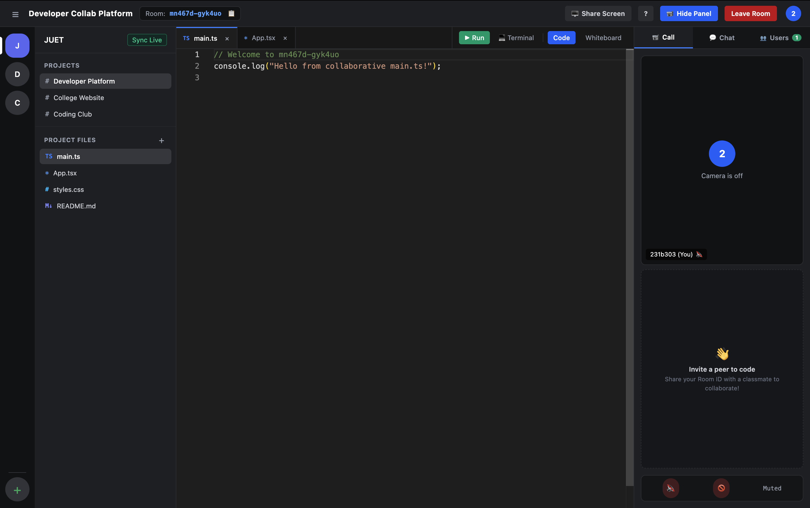

# Real-Time Collaborative Developer Platform



A cross-platform desktop app where developers write code together in real time. It combines multi-file collaborative editing, a shared whiteboard, screen sharing, video/voice, chat and an in-app code runner in one window, so there is no need to juggle an editor, a meeting tool and a diagramming tool.

## Features

- **Collaborative multi-file editing:** several people edit the same project at once in Monaco Editor (the editor behind VS Code), with no locking and no merge conflicts.
- **CRDT synchronization:** powered by Yjs, so simultaneous edits always converge to the same result.
- **Shared project explorer:** files and folders sync live across everyone in the room, with a multi-tab editor and language badges.
- **Whiteboard:** draw system architecture diagrams with tldraw, with local IndexedDB persistence.
- **Video, voice and screen share:** native window and screen capture through Electron's `desktopCapturer`, with a `getDisplayMedia` fallback.
- **Presence and chat:** live user roster and synchronized text chat via Yjs Awareness.
- **Built-in code runner and terminal:** run JavaScript/TypeScript inside the app and see the output in an embedded terminal.
- **Authentication and rooms:** Firebase email/password login, with generated Room IDs to invite others.
- **Keyboard shortcuts:** press `?` to see them, including `Cmd+B` and `Cmd+Enter`.
- **Desktop packaging:** `.dmg` and `.exe` installers through electron-builder.

## Tech Stack

| Layer | Technology |
| :--- | :--- |
| Desktop shell | Electron |
| Frontend | React 19, TypeScript, Vite |
| Styling | Tailwind CSS 4 |
| Editor | Monaco Editor |
| Real-time sync | Yjs, y-monaco, WebSocket signaling server |
| Whiteboard | tldraw |
| Auth | Firebase Authentication |
| Packaging | electron-builder |

## Architecture

The app uses Electron's process isolation model:

```
src/
├── main/       # Electron main process: app lifecycle, native APIs, embedded signaling server
├── preload/    # Secure IPC bridge (contextBridge) between main and renderer
├── renderer/   # React app: editor, explorer, whiteboard, video call, terminal, auth
└── server/     # Yjs WebSocket server
tests/          # Automated tests
```

Shared state (documents, the file tree, chat and presence) lives in Yjs documents that sync between peers through the WebSocket server, which is what keeps everyone consistent without a central lock.

## Getting Started

### Prerequisites

- Node.js 18 or newer
- npm

### Setup

```bash
git clone https://github.com/ShailendarRawat/Colloborative-Developer-Platform.git
cd Colloborative-Developer-Platform
npm install
cp .env.example .env
```

`.env` holds the signaling server URL. The default works for local development:

```
VITE_SIGNALING_URL=ws://localhost:1234
```

For a deployed server (Render, Railway, Fly.io, etc.), use a `wss://` URL instead.

### Run

```bash
npm run dev
```

### Test

```bash
npm test
```

The suite covers file-type detection, the code runner, and Yjs synchronization (concurrent edits, multi-file state, chat and presence).

## Roadmap

- Language Server Protocol support for richer autocomplete and linting
- SFU-based video (for example LiveKit) for larger rooms
- GitHub integration for syncing and committing from the app

## Author

**Shailendar Rawat**
GitHub: [@ShailendarRawat](https://github.com/ShailendarRawat)
